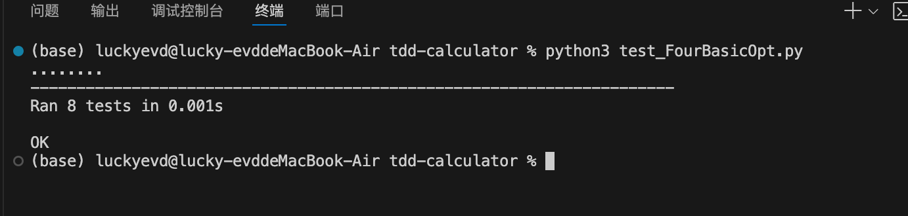
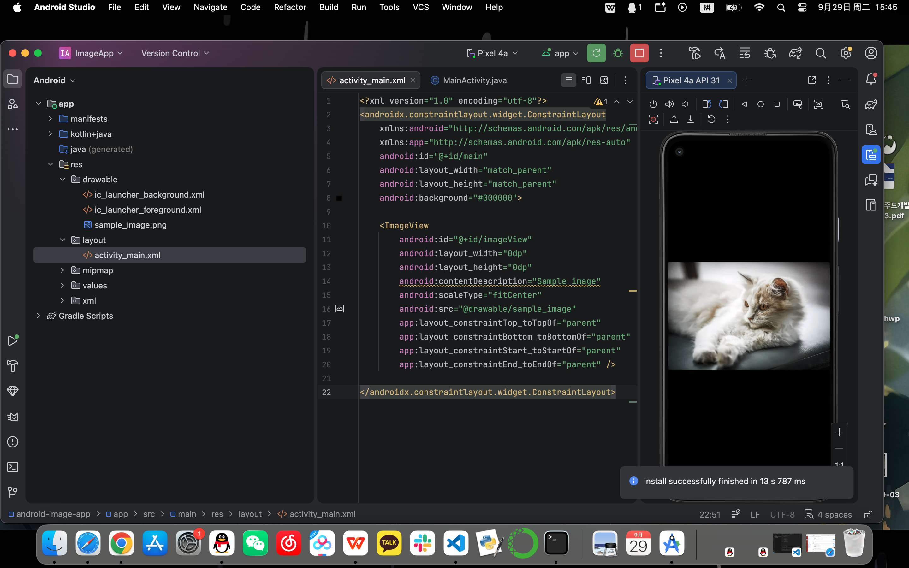

# 실습과제 05

## 1. TDD 사칙연산

Python의 unittest를 사용하여 덧셈, 뺄셈, 나눗셈, 곱셈 기능을 테스트 주도 개발 방식으로 구현했습니다.

### 실행 방법

```bash
cd tdd-calculator
python3 -m unittest test_FourBasicOpt.py
```

### 실행 결과



## 2. Android 이미지 앱

Android Studio와 Java를 사용하여 한 화면에 이미지를 표시하는 애플리케이션을 구현했습니다.

### 실행 결과

